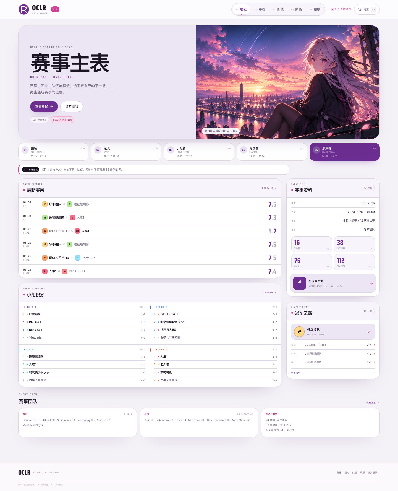

# OCLR MainSheet Light · 设计说明

## 1. 方向：Official Event Site / 轻量活动页

上一版「Matchday Ledger」把主表做成了印刷公报，结构清楚，但整体更像一份派发文件，和官方 S11 的视觉资产脱节；更早的「控制台」方案则把后台侧栏、大表格和右侧检查器带进了公开页。参考 [PhoenixEmik/OCLR-website](https://github.com/PhoenixEmik/OCLR-website) 后，方向改为：

> **先是一个赛事，再是一张主表。**

公开页以官方 S11 key visual 建立赛事识别，顶部 tabs 组织章节，页面用浅薰衣草底、白面、圆角面板和紫色 / 粉色强调色承托内容；赛程是比赛卡，图池是圆角封套，队伍是识别色卡片，规则是连续文章。左侧全局侧栏、右侧常驻检查器和运营 KPI 不作为公开主表外壳。

这一版保留参考站最有价值的结构差异：**公开赛事资料与主办后台分开**。当前页面是选手和主办都能阅读的公开只读层；审核、改比分、排裁判等操作应在后续独立的管理页完成，不混入主表布局。

## 2. 识别点

1. **官方 S11 封面**：概览首屏左侧是赛事标题与动作，右侧直接使用官方 key visual；紫色天空、粉色高光和角色成为页面唯一的大面积图像。
2. **顶部横向 tabs**：概览 / 赛程 / 图池 / 队伍 / 规则；当前项是白色圆角胶囊 + 粉色圆点，不使用后台侧栏，也不使用传统下划线 tab。
3. **圆角几何**：hero 30px、页面头 30px、面板 22px、卡片 18px、按钮 / 筛选 / 状态 999px；队伍徽章、阶段编号、工具按钮都是圆形。圆角不是装饰性贴纸，而是布局层级的一部分。
4. **浅薰衣草纸面**：页面底色 `#f4f1f7`，内容面白色或 `#f8f4fb`；没有大面积渐变、光晕、噪点或玻璃拟态。只有官方封面和程序化图池封套使用图像纹理。
5. **比赛卡优先**：赛程按阶段分组，一张卡完成日期、对阵、比分、裁判、转播、MP 与展开详情；需要扫全量时切到紧凑视图。
6. **同一套圆角语言贯穿**：图池阶段 tabs、摘要统计、谱面卡、队伍卡、规则目录和抽屉都使用同一组圆角与描边，不再出现「海报 + 后台表格」两套语法。

## 3. 配色

| 角色 | Token | 色值 |
|---|---|---|
| 页面底色 | `--bg` | `#f4f1f7` |
| 内容面 | `--surface` | `#ffffff` |
| 浅薰衣草面 | `--surface-2` / `--lav` | `#f8f4fb` / `#ece5f3` |
| 主文字 | `--ink` | `#1b1422` |
| 次级文字 | `--muted` | `#6d6278` |
| 元数据 | `--dim` | `#8a7e95` |
| 分割线 | `--line` | `#ded5e7` |
| 官方主紫 | `--purple` | `#6c2e91` |
| 官方粉 | `--pink` | `#d23f95` |
| 冠军金 | `--gold` | `#b17b18` |
| 阶段蓝 / 青 / 橙 | `--blue` / `--teal` / `--orange` | `#3a6fd8` / `#0f8b80` / `#c25a2c` |

紫色承担品牌、主按钮、选中态和赢家比分；粉色承担强调、编号、状态点和少量标题；阶段色只做数据标记，不铺大面积背景。

## 4. 字体、形状与材质

- **字体**：Saira Condensed 用于比分、统计数字、页面英文标签和阶段编号；Inter / 系统中文字体用于正文；JetBrains Mono 用于日期、编号、英文元数据与数据注记。字体内嵌在 `css/fonts.css`，`file://` 直接打开也不掉排版；更换字体后运行 `python3 tools/embed_fonts.py`。
- **圆角**：`--radius-xl: 30px`（hero / 页面头）、`--radius-lg: 22px`（面板）、`--radius-md: 16px`（子卡片）、`999px`（按钮 / chips / tabs / 比分胶囊）。队伍徽章 50%，阶段编号 50%。
- **材质**：UI 表面为纯色；阴影只用于让白面从薰衣草底上浮起，强度很低（`0 24px 60px -44px`）。不使用大面积模糊、霓虹光或彩色渐变底。
- **动效**：页面淡入、hover 小幅上浮、抽屉/搜索的圆角面板进入、比分与筛选的即时反馈；`prefers-reduced-motion` 下关闭。没有自动轮播或持续漂浮装饰。
- **官方资产**：`assets/oclr-s11-hero.webp` 用于概览 hero；`assets/oclr-s11-key-visual.webp` 用于 `og:image`。品牌圆标、favicon 与界面图形由项目本地 SVG/CSS 生成。

## 5. 页面结构

### 概览

- 顶部站点栏：OCLR 圆标、S11 胶囊、五枚横向 tabs、搜索。
- `event-hero`：左侧赛季、标题、导语、查看赛程 / 当前图池、S8 示例与预览标签；右侧官方 S11 key visual。
- 阶段进度：报名 / 选人 / 小组赛 / 淘汰赛 / 总决赛五张圆角卡片，当前阶段紫色，其余白色。
- 主栏：最新赛果（6 场）与 2×2 小组积分；侧栏：赛事资料（日期、赛制、冠军、四项规模、当前图池）与冠军之路。
- 底部：裁判 / 转播 / 图池数据三张圆角卡片。

### 赛程

- 圆角页面头：标题、说明、四项统计、示例提示。
- 顶部工具栏：阶段 pills、卡片 / 紧凑视图切换、小组筛选、搜索、匹配数。
- **卡片视图**：按 A–D 组 / 半决赛 / 决赛 / 总决赛分组；每张卡显示日期、阶段、队伍、比分、裁判、转播、MP；展开显示 Ban、MP/VOD/图池链接与完整时间。
- **紧凑视图**：同一组数据，按阶段块排列为行；桌面保留裁判 / 转播列，窄屏收起。视图选择写入 `localStorage`。
- 深链接 `#/schedule/m38` 会打开对应卡片；筛选项和视图状态互不破坏。

### 图池

- 横向阶段 tabs：小组赛 / 半决赛 / 决赛 / 总决赛；当前项紫色。
- 当前图池摘要：地图数、平均 SR、平均 BPM、时长与 mod 分布条。
- mod chips、搜索、排序、导出 JSON、复制 `!mp`、Mappack。
- 圆角谱面卡：程序化色块封套 + slot 幽灵字 + 曲名 / 难度 / mapper / BPM / 时长；点击打开抽屉。
- 抽屉：圆角封套、谱面信息、裁判指令、复制与上一张 / 下一张。

### 队伍

- 圆角页面头与队伍筛选：全部 / Group A–D，搜索队伍、队长、教练。
- 2×2 队伍卡：圆形识别徽章、顶部识别色条、组内位置、战绩与队长 / 教练；冠军卡金色描边。
- 右侧小组积分：按组显示胜–负、地图胜–负、晋级标记；桌面吸顶。
- 移动端名单单列，积分区移到名单之后并提供返回跳转。

### 规则

- 与赛程 / 图池相同的圆角页面头：版本、更新、章节数。
- 目录 + 连续文章页 + 赛制速览三栏；目录当前项为薰衣草胶囊。
- 章节用粉色编号和细分隔线；NOTE 为粉色左线浅粉条；表格表头为紫色。
- 移动端隐藏侧栏、显示折叠目录，章节表允许换行不再横向裁切。

## 6. 响应式与可达性

- 断点：1320 / 1120 / 980 / 900 / 760 / 600 / 380px。
- 900px 以下隐藏顶部 tabs，使用圆形菜单按钮展开移动导航；搜索缩为图标。
- 980px 以下 hero 单列、概览侧栏落到主栏下方；赛程卡片单列；队伍工作区单列；规则侧栏收起。
- 760px 以下阶段进度改为横向滑动条；页面头统计 2×2；图池卡单列；紧凑行隐藏裁判 / 转播列。
- 交互控件 30–44px 最小高度、`:focus-visible` 粉色描边、搜索支持 `⌘K` / `/`、Esc、↑↓ 与回车。
- 示例数据、S11 预览、规则结构示例提示始终保留。

## 7. 数据边界

- `js/data.js`、`js/rules.js`、`js/brand.js` 的赛事数据与文案未改写。
- 标题、封面、赛果、积分、队伍、图池与规则均由现有数据生成，不新造比分、名次或链接。
- S8 示例数据、S11 预览、规则结构示例的提示全部保留。
- 无远程图片、字体或第三方 UI 库请求；官方 S11 图像已放入 `assets/`。

## 8. 本轮验证

- `node tools/capture.js`：五个页面 1440 / 390 整页截图全部生成；
- `CAPTURE_VIEWPORTS=1024x1000,768x1000` 抽查中宽，检查 hero、顶部 tabs、统计与卡片列宽；
- `node tools/capture-states.js`：搜索、桌面/移动抽屉、赛程阶段筛选、**卡片 / 紧凑切换**、深链接、队伍分组、图池 TB、移动菜单全部通过；
- 断言：决赛筛选 `4 / 38`、紧凑视图 `0` 张卡片且 `1` 个阶段块、深链接打开 M38、C 组筛选 `4 / 16`、GF TB 筛选 `1 / 19`、总决赛筛选 `2 / 38`；
- DOM 审计：五页均有且仅有一个 `h1`、无重复 ID、1440/390 无横向溢出、700 字重 Saira 加载成功；
- 浏览器控制台无异常；字体内嵌后 `file://` 下不再出现字体 CORS 错误；
- 视觉结果以 `preview/` 截图为最终依据，未在真实浏览器做逐像素测量。
