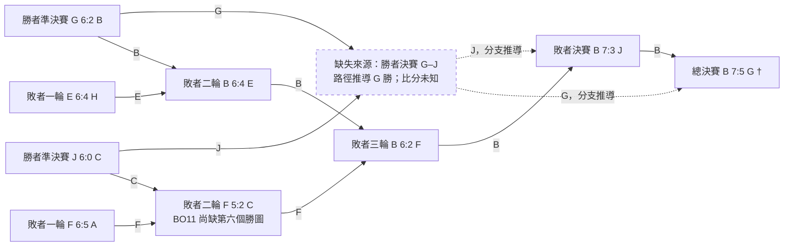

# S6 小組賽、淘汰對陣與結果重建（待覆核）

使用主辦者更正後提供的 33 個 2021 年 MP，以及後補的 [S6 規則](https://docs.qq.com/doc/DUHFuRFBER1NKS3Bw)。先前撤回的 2020 年對局完全排除；規則連結不保存 QQ 追蹤參數。

已核對 33 場完整分頁、共 348 局遊戲。按譜面 ID 可確認 GS 圖池 23 場、ES 圖池 8 場、FS 圖池 2 場；本批沒有資格賽、測試賽或 Showcase 房間。65 局圖池外的開場遊戲及 20 局無結束時間、全員零分的中止遊戲不計勝圖。另有四次完整重打暫採最後一次；D–I 最後一局 TB 暫列賽後娛樂，候選賽事合計 258 局，原始紀錄均保留。

**所有比分、分支與名次仍是重建資料，沒有寫入正式站或批准為官方賽果。** 依主辦者最新指示，D–I 暫按 3:5、最後 TB 為賽後娛樂；C–F 保留實打 2:5，另註 HD2 可能有未記錄勝點而實際為 2:6。兩項均標示待確認，不代表主辦者已確認歷史賽果。G–J 勝者組決賽仍未取得 MP。

來源：[MP 清單](imports/s6-match-manifest.json)、[分頁核對後的競賽快照](imports/s6-match-source-snapshot.json)、[規則事實摘要](imports/s6-rules-facts.json)、[機器可讀重建](imports/s6-match-reconstruction.json)。原工作簿名單、現行角色及正式資料未更動。

## 規則確認後的結構

- 採 Score v1；個人 Fail 分數保留，整隊 Team Fail 判負，No Fail 可自行開啟。逐局核對到一個 Team Fail：D–I 的遊戲 432255879 藍方；它與原始總分勝負相同，因此沒有改變任何重建比分。
- 小組階段是四輪瑞士輪、12 進 8、BO9。文件中兩組循環的舊提案已劃除，不採用。
- 瑞士輪前四隊直接進勝者組，後四隊直接進敗者組；兩組第一名均可挑選其淘汰賽對手。不是八隊全部從勝者組起跑。
- 淘汰階段 BO11；敗者組決賽及總決賽 BO13。規則沒有寫出總決賽重置或勝者方讓分，不能自行添加。
- Extra 用於 NM1／HD1／HR1／DT1，限制 Captain／VICE／Tier 1 同時上場的人數；它沒有額外計分倍率。規則亦允許 NM 單開 HR／HD／EZ，不額外調整原始分數。不能單憑加了 Mod 就剔除某局。
- 重賽有每隊一次及掉線、SS 分差門檻、裁判判定等條件；開場 30 秒內中止及指定裁判例外不消耗次數。這些條文不等於證明每一場實際獲准重打。

規則的原定日期是瑞士輪 5 月 8–30 日、淘汰 6 月 5–13 日、決賽 6 月 19–20 日；MP 有延後紀錄，保留實際日期。下述輪次由規則與對手／路徑共同重建，並非另有完整原始對陣表。

## 隊伍名稱對照

原表及帶字母的房名建立名稱對照；已知一側名稱及雙方 UID 時，才推定唯一另一側。紅藍隊依名單 UID 的多數證據確認，房名順序不能代替紅藍順序。I、J 仍無可靠隊名。

| 代號 | 來源隊名         |
| ---- | ---------------- |
| A    | 饮茶先啦         |
| B    | 队长是隐形播放器 |
| C    | 猫娘别演了       |
| D    | 只练二次元图     |
| E    | 爆炸奶油面包V2   |
| F    | aoi被圣遗物气晕  |
| G    | 超级敏感         |
| H    | 你寄吧谁         |
| I    | 未記錄           |
| J    | 未記錄           |
| K    | 我只会心疼白果果 |
| L    | 不练傻逼图       |

## 瑞士輪對陣

按時間可排出四批、每批十二隊各出現一次。前三批與規則及 GS 圖池一致；第四批 D–I 雖使用 ES，現暫按瑞士輪 3:5 處理，最後五對五 TB 作賽後娛樂，不計入候選小組戰績。該處理及使用 ES 的原因均待確認。日期是實際房間建立日（UTC+8），不覆蓋原表預定時間。† 表示完整重打仍待裁判結論。

### 第 1 輪重建

| 日期（UTC+8） | 重建輪次 | 對局 | 比分 | 勝方 | 圖池 | MP／備註                                                  |
| ------------- | -------- | ---- | ---- | ---- | ---- | --------------------------------------------------------- |
| 2021-05-08    | 瑞士輪   | A–G  | 5:4  | A    | S6GS | [82845235](https://osu.ppy.sh/community/matches/82845235) |
| 2021-05-08    | 瑞士輪   | H–C  | 4:5† | C    | S6GS | [82845405](https://osu.ppy.sh/community/matches/82845405) |
| 2021-05-08    | 瑞士輪   | D–K  | 5:0  | D    | S6GS | [82845547](https://osu.ppy.sh/community/matches/82845547) |
| 2021-05-09    | 瑞士輪   | B–F  | 1:5† | F    | S6GS | [82930484](https://osu.ppy.sh/community/matches/82930484) |
| 2021-05-09    | 瑞士輪   | J–L  | 5:0  | J    | S6GS | [82930784](https://osu.ppy.sh/community/matches/82930784) |
| 2021-05-09    | 瑞士輪   | E–I  | 5:3  | E    | S6GS | [82930832](https://osu.ppy.sh/community/matches/82930832) |

### 第 2 輪重建

| 日期（UTC+8） | 重建輪次 | 對局 | 比分 | 勝方 | 圖池 | MP／備註                                                  |
| ------------- | -------- | ---- | ---- | ---- | ---- | --------------------------------------------------------- |
| 2021-05-14    | 瑞士輪   | E–F  | 5:3  | E    | S6GS | [83303988](https://osu.ppy.sh/community/matches/83303988) |
| 2021-05-15    | 瑞士輪   | G–L  | 5:3† | G    | S6GS | [83393789](https://osu.ppy.sh/community/matches/83393789) |
| 2021-05-15    | 瑞士輪   | D–C  | 3:5  | C    | S6GS | [83394664](https://osu.ppy.sh/community/matches/83394664) |
| 2021-05-15    | 瑞士輪   | A–J  | 3:5  | J    | S6GS | [83398093](https://osu.ppy.sh/community/matches/83398093) |
| 2021-05-15    | 瑞士輪   | H–K  | 5:4  | H    | S6GS | [83398400](https://osu.ppy.sh/community/matches/83398400) |
| 2021-05-16    | 瑞士輪   | B–I  | 5:3  | B    | S6GS | [83477715](https://osu.ppy.sh/community/matches/83477715) |

### 第 3 輪重建

| 日期（UTC+8） | 重建輪次 | 對局 | 比分 | 勝方 | 圖池 | MP／備註                                                  |
| ------------- | -------- | ---- | ---- | ---- | ---- | --------------------------------------------------------- |
| 2021-05-22    | 瑞士輪   | H–B  | 0:5  | B    | S6GS | [83947345](https://osu.ppy.sh/community/matches/83947345) |
| 2021-05-22    | 瑞士輪   | L–I  | 5:4  | L    | S6GS | [83950720](https://osu.ppy.sh/community/matches/83950720) |
| 2021-05-22    | 瑞士輪   | C–A  | 5:2  | C    | S6GS | [83950883](https://osu.ppy.sh/community/matches/83950883) |
| 2021-05-23    | 瑞士輪   | D–G  | 1:5  | G    | S6GS | [84030371](https://osu.ppy.sh/community/matches/84030371) |
| 2021-05-23    | 瑞士輪   | E–J  | 1:5  | J    | S6GS | [84033167](https://osu.ppy.sh/community/matches/84033167) |
| 2021-05-24    | 瑞士輪   | F–K  | 5:4  | F    | S6GS | [84102904](https://osu.ppy.sh/community/matches/84102904) |

### 第 4 輪候選批次

| 日期（UTC+8） | 重建輪次         | 對局 | 比分 | 勝方 | 圖池 | MP／備註                                                                                                  |
| ------------- | ---------------- | ---- | ---- | ---- | ---- | --------------------------------------------------------------------------------------------------------- |
| 2021-05-28    | 瑞士輪（待確認） | D–I  | 3:5  | I    | S6ES | [84398168](https://osu.ppy.sh/community/matches/84398168)；暫按 3:5，末局 TB 賽後娛樂；整房 3:6（待確認） |
| 2021-05-29    | 瑞士輪           | A–K  | 5:0  | A    | S6GS | [84482290](https://osu.ppy.sh/community/matches/84482290)                                                 |
| 2021-05-29    | 瑞士輪           | J–C  | 5:2  | J    | S6GS | [84483533](https://osu.ppy.sh/community/matches/84483533)                                                 |
| 2021-05-30    | 瑞士輪           | E–B  | 4:5  | B    | S6GS | [84554110](https://osu.ppy.sh/community/matches/84554110)                                                 |
| 2021-05-30    | 瑞士輪           | F–G  | 3:5  | G    | S6GS | [84554459](https://osu.ppy.sh/community/matches/84554459)                                                 |
| 2021-06-01    | 瑞士輪           | H–L  | 5:1  | H    | S6GS | [84686450](https://osu.ppy.sh/community/matches/84686450)                                                 |

### 小組戰績與兩套口徑

左側只計 23 場 GS 圖池；右側暫將 D–I 以 3:5 列入第四輪，不計最後的娛樂 TB。故候選得失圖更新為 D 12–15、I 15–18，兩隊勝負仍各為 1–3。兩表都沿用重打假設，且 D–I 處理仍待確認；右側不是正式積分。原文排序依序為勝場、直接勝負及「净胜场」；第三項沒有進一步定義，不擅自把得失圖排序當成已接受的完整種子。

| 隊伍 | GS 場數 | GS 勝–負 | GS 得–失圖 | 四批候選勝–負 | 四批候選得–失圖 |
| ---- | ------- | -------- | ---------- | ------------- | --------------- |
| A    | 4       | 2–2      | 15–14      | 2–2           | 15–14           |
| B    | 4       | 3–1      | 16–12      | 3–1           | 16–12           |
| C    | 4       | 3–1      | 17–14      | 3–1           | 17–14           |
| D    | 3       | 1–2      | 9–10       | 1–3           | 12–15           |
| E    | 4       | 2–2      | 15–16      | 2–2           | 15–16           |
| F    | 4       | 2–2      | 16–15      | 2–2           | 16–15           |
| G    | 4       | 3–1      | 19–12      | 3–1           | 19–12           |
| H    | 4       | 2–2      | 14–15      | 2–2           | 14–15           |
| I    | 3       | 0–3      | 10–15      | 1–3           | 15–18           |
| J    | 4       | 4–0      | 20–6       | 4–0           | 20–6            |
| K    | 4       | 0–4      | 8–20       | 0–4           | 8–20            |
| L    | 4       | 1–3      | 9–19       | 1–3           | 9–19            |

按目前重建，J 四勝，B／C／G 各三勝，對應勝者組四隊；A／E／F／H 對應敗者組四隊。這兩組與六月實際對陣相符。第一名可選對手，所以不能只按固定 1–4、2–3 配對反推精確種子。D／I／K／L 尚不能分配官方 9–12 名順序。

## 淘汰賽對陣與結果

| 日期（UTC+8） | 重建輪次      | 對局 | 比分 | 勝方 | 圖池 | MP／備註                                                                                              |
| ------------- | ------------- | ---- | ---- | ---- | ---- | ----------------------------------------------------------------------------------------------------- |
| 2021-06-04    | 敗者組第 1 輪 | A–F  | 5:6  | F    | S6ES | [84896923](https://osu.ppy.sh/community/matches/84896923)                                             |
| 2021-06-05    | 勝者組準決賽  | B–G  | 2:6  | G    | S6ES | [84972689](https://osu.ppy.sh/community/matches/84972689)                                             |
| 2021-06-06    | 敗者組第 1 輪 | E–H  | 6:4  | E    | S6ES | [85044339](https://osu.ppy.sh/community/matches/85044339)                                             |
| 2021-06-08    | 勝者組準決賽  | J–C  | 6:0  | J    | S6ES | [85172398](https://osu.ppy.sh/community/matches/85172398)                                             |
| 2021-06-12    | 敗者組第 2 輪 | B–E  | 6:4  | B    | S6ES | [85439390](https://osu.ppy.sh/community/matches/85439390)                                             |
| 2021-06-13    | 敗者組第 2 輪 | C–F  | 2:5  | F    | S6ES | [85503945](https://osu.ppy.sh/community/matches/85503945)；實打 2:5，HD2 可能缺一分而為 2:6（待確認） |
| 2021-06-14    | 敗者組第 3 輪 | B–F  | 6:2  | B    | S6ES | [85546490](https://osu.ppy.sh/community/matches/85546490)                                             |
| 2021-06-26    | 敗者組決賽    | J–B  | 3:7  | B    | S6FS | [86302764](https://osu.ppy.sh/community/matches/86302764)                                             |
| 2021-06-27    | 總決賽        | G–B  | 5:7† | B    | S6FS | [86362224](https://osu.ppy.sh/community/matches/86362224)                                             |

規則確認前四隊從勝者組、後四隊從敗者組起跑後，所需的主要結構缺口縮小為一場：**G–J 勝者組決賽**。G 和 J 分別贏下兩場勝者組準決賽，後續 J 出現在敗者組決賽、G 出現在總決賽，因此能推導 G 贏該勝者決賽；但沒有 MP、日期及比分，以下只畫為缺失來源節點，未建立正式賽果。



B 的已知出場路徑為：勝者組 2:6 負 G → 敗者組 6:4 勝 E → 6:2 勝 F → 敗者決賽 7:3 勝 J → 總決賽候選 7:5 勝 G。所有實線比賽都有 MP；虛線所連的 G–J 只由結構推導。

### 條件式名次整理

若主辦者接受四場重打判定、確認最後一場確為賽事終局且沒有未提供的重置／後續裁定，則可按這條路徑整理如下。C–F 的正式比分仍需補正或接受其來源缺漏。這是待覆核的名次整理，JSON 的正式排名仍保持空白。

| 候選名次             | 隊伍                           |
| -------------------- | ------------------------------ |
| 1                    | B 队长是隐形播放器             |
| 2                    | G 超级敏感                     |
| 3                    | J（隊名未知）                  |
| 4                    | F aoi被圣遗物气晕              |
| 5–6                  | C 猫娘别演了／E 爆炸奶油面包V2 |
| 7–8                  | A 饮茶先啦／H 你寄吧谁         |
| 未晉級候選；順序未知 | D／I／K／L                     |

## 四場完整重打覆核

重賽規則支持檢查重複譜面的必要性，但不能代替該場裁判判決。同一譜面兩次已完成紀錄，分別保留全部加總及採最後一次的候選值。

| MP                                                        | 對局 | 全部已完成加總 | 最後一次候選比分 | 先前遊戲 → 後次遊戲（BID）       |
| --------------------------------------------------------- | ---- | -------------- | ---------------- | -------------------------------- |
| [82845405](https://osu.ppy.sh/community/matches/82845405) | H–C  | 5:5            | 4:5              | 425185357 → 425187750（2945758） |
| [82930484](https://osu.ppy.sh/community/matches/82930484) | B–F  | 1:6            | 1:5              | 425567320 → 425570123（2519731） |
| [83393789](https://osu.ppy.sh/community/matches/83393789) | G–L  | 5:4            | 5:3              | 427657050 → 427658605（1805552） |
| [86362224](https://osu.ppy.sh/community/matches/86362224) | G–B  | 6:7            | 5:7              | 441655590 → 441657037（483199）  |

H–C 直接累加會變成 5:5，只有最後一次重打假設得到 H 4:5 C，因此該場勝方及小組戰績也依賴重打覆核。其他三場的兩種加總方式不改變勝方。四次較早紀錄的一方均只有兩位非零分選手，重打後回到三位；這支持斷線重打的推測，並不證明已獲裁判批准。

## D–I／C–F 暫定推理（均待確認）

### D–I：暫按 3:5，末局 TB 作賽後娛樂

[D–I（84398168）](https://osu.ppy.sh/community/matches/84398168) 在 2021-05-28 21:20:51（UTC+8）完成第八張圖池圖 NM2，比分已到 D 3:5 I，符合 BO9 終點。21:29:30 才再開 TB，21:34:17 結束；前八圖每方各三名非零分選手，這張卻各有五名。TB 開打前不是平分，且 D–I 恰好補齊第四輪兩隊的出場，因此暫採『正式候選 3:5，末局為娛樂』解讀。

原始整房加總 3:6、最後 TB 的遊戲 432260817／BID 2968871、分數與時間全部保留；只從暫定賽事比分及候選積分中排除該局。使用 ES 圖池的原因、現場是否確實如此處理，仍未取得當時佐證。主辦者目前只要求暫按此推理整理，並非確認歷史結果。

### C–F：實打維持 2:5，可能缺 HD2 的一個 F 勝點

[C–F（85503945）](https://osu.ppy.sh/community/matches/85503945) 在 2021-06-13 21:29:06 開 HD2（遊戲 437459269／BID 2844989），MP 沒有結束時間及任何分數，直到 21:43:54 才開始下一張。最後一張在 22:21:44 結束，已完成遊戲合計 C 2:5 F，49 秒後房間解散；翌日 F 已進入 B–F 的下一輪。

若 HD2 有未保存的結算或現場判給 F 的一點，最終便可能是符合 BO11 的 C 2:6 F。此解讀比整輪改為 BO9 更符合相鄰 B–E、B–F 均打到六勝的紀錄，但目前沒有 HD2 勝負或裁判判分的直接證據；臨場改 BO9 或提前結束也無法排除。『無結算』不能直接證明主動 Abort、F 勝、棄權或罰分。

因此表格與實打統計仍為 2:5，2:6 僅放在待確認的可能正式比分欄，不新增遊戲、選手分數或裁定。

## 仍需共同推理／補充的項目

1. D–I 的暫定 3:5／末局娛樂處理及使用 ES 的原因仍待當時紀錄或裁判佐證；原始整房 3:6 保留。
2. C–F 實打 2:5 不變；HD2 是否存在未記錄的 F 勝點、實際是否 2:6，仍待確認。
3. G–J 勝者組決賽的 MP、比分及日期尚缺。僅把 G 勝當成後續分支所需的結構推導。
4. 確認四場完整重打的實際裁判處理；開場中止不等於已完成重打，兩類分開核對。
5. 部分 A/B 原表 UID 跨隊出場（15174317、13679569 等）。實際分數保留，不自行重寫 roster 或判定違規。Extra 的上場宣告／選圖方亦不能從比分單獨還原。
6. I/J 隊名、精確小組種子、總決賽終局性與最終排名仍待主辦者接受；規則沒有重置條文，不等於證明沒有遺漏後續賽事。

## 來源與重現

公開 MP 以未登入 JSON、after 遞增分頁讀取，核對首尾事件及穩定結束狀態；不讀本機秘密。只保留競賽事實及公開 UID／名稱，不保存聊天與無關個人欄位。QQ 規則是人工閱讀其唯讀畫面、包含劃除格式與文末後整理的事實摘要，不是全文重刊。

```sh
python3 scripts/fetch-s6-match-sources.py docs/imports/s6-match-manifest.json /tmp/s6-match-source-snapshot.json
python3 scripts/reconstruct-s6-matches.py docs/imports/s6-match-source-snapshot.json docs/imports/s6-source-records.json docs/imports/s6-pool-source-snapshot.json docs/imports/s6-rules-facts.json docs/imports/s6-match-reconstruction.json --report docs/s6-match-reconstruction.md
PYTHONDONTWRITEBYTECODE=1 python3 -m unittest discover -s tests/scripts -p 'test_s6_match_reconstruction.py'
```

快照重取後先比較，不直接覆蓋已審查證據。本階段不部署、不匯入、不發布正式資料。
